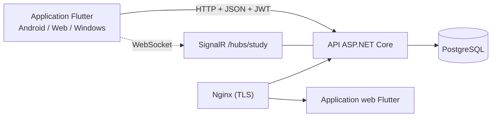

<p align="center"></p>

<h1 align="center">Study Timer</h1>

<p align="center">
Application de gestion du temps d'étude : chronomètre, Pomodoro, défis entre étudiants, classements, badges, salles d'étude et planificateur.
</p>

<p align="center">


</p>


## Fonctionnalités

| Module | Contenu |
|---|---|
| Authentification | Inscription, connexion JWT avec refresh, profil et fuseau horaire |
| Chronomètre | Focus, Pomodoro, Stopwatch ; pause/reprise ; calcul côté serveur (fiable en arrière-plan) ; reprise après redémarrage |
| Défis | Temps total, nombre de séances, série de jours, plus longue séance ; invitations ; classement par défi |
| Gamification | XP, niveaux, 8 badges, séries quotidiennes |
| Statistiques | Jour / semaine / mois, moyenne, séries, répartition par matière, calendrier d'activité (heatmap) |
| Communauté | Amis (invitation, acceptation), activité et statistiques des amis, confidentialité réglable |
| Salles d'étude | Salles publiques ou privées (code), statut des participants, chat |
| Planificateur | Tâches avec échéance, priorité, durée estimée, tâches en retard, association à une séance |
| Notifications | Centre de notifications (invitations, acceptations) |

La conformité détaillée au cahier des charges est dans [docs/CONFORMITE.md](docs/CONFORMITE.md).

## Architecture



| Couche | Technologie |
|---|---|
| Mobile / web | Flutter, Dart, dio |
| API | ASP.NET Core (net10.0), Entity Framework Core, Swagger |
| Base de données | PostgreSQL |
| Temps réel | SignalR |
| Déploiement | Docker Compose, Nginx, sauvegardes quotidiennes |
| Qualité | xUnit (tests API et règles métier), flutter test, GitHub Actions |

## Démarrage rapide

### 1. Backend

```powershell
# secrets hors du code (une seule fois)
dotnet user-secrets set "Jwt:Key" "une-cle-de-32-caracteres-minimum-xxxxxxxx" --project backend/StudyTimer.Api
dotnet user-secrets set "ConnectionStrings:Default" "Host=localhost;Database=studytimer;Username=studyuser;Password=..." --project backend/StudyTimer.Api

dotnet run --project backend/StudyTimer.Api --urls http://0.0.0.0:5293
```

Swagger : http://localhost:5293/swagger

### 2. Application

```powershell
cd mobile/study_timer
flutter pub get
flutter run -d chrome
# téléphone Android (même Wi-Fi que le PC) :
flutter run --dart-define=API_URL=http://<IP-DU-PC>:5293
```

### 3. Déploiement (Docker + Nginx + TLS)

```powershell
.\deploy\scripts\New-Secrets.ps1 -PublicUrl https://votre-domaine   # génère .env (ne jamais le commiter)
docker compose up -d --build
```

Voir [GUIDE.md](GUIDE.md) pour l'installation et l'administration complètes.

## Tests

```powershell
dotnet test backend/StudyTimer.slnx
cd mobile/study_timer ; flutter test
```

## Scripts

Les scripts d'aide sont dans [scripts/](scripts/README.md) : diagnostic de conformité, génération de modules, logo, publication GitHub.

## Structure du dépôt

```text
backend/            API ASP.NET Core (Api, Domain, Infrastructure, Tests)
mobile/study_timer/ Application Flutter
deploy/             Nginx, sauvegarde / restauration, certificats de test
scripts/            Scripts PowerShell d'aide
docs/               Documentation, conformité, images
docker-compose.yml  PostgreSQL + API + Nginx + sauvegardes
```

## Feuille de route

- Speed Race et code de partage des défis
- Photo de profil, suppression de compte
- Notifications locales et mode hors-ligne
- Internationalisation français / anglais / arabe
- Ambiances sonores, version iOS, assistant IA

## Auteur

Projet réalisé dans le cadre d'un mini-projet de développement mobile avancé.


